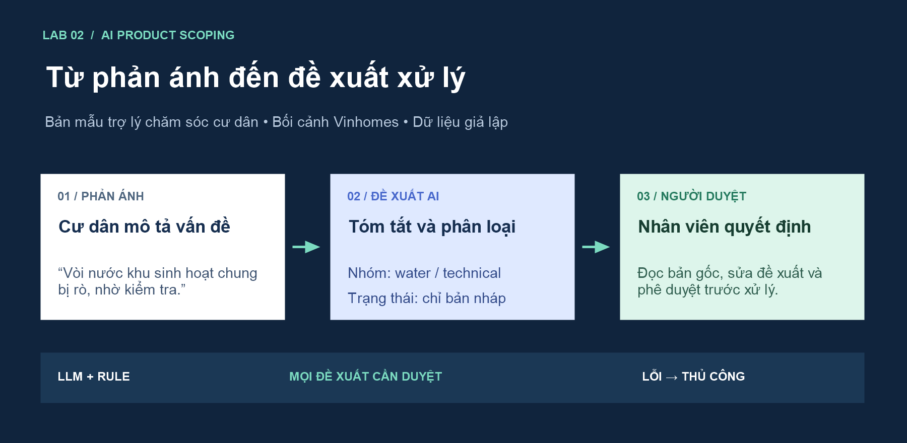
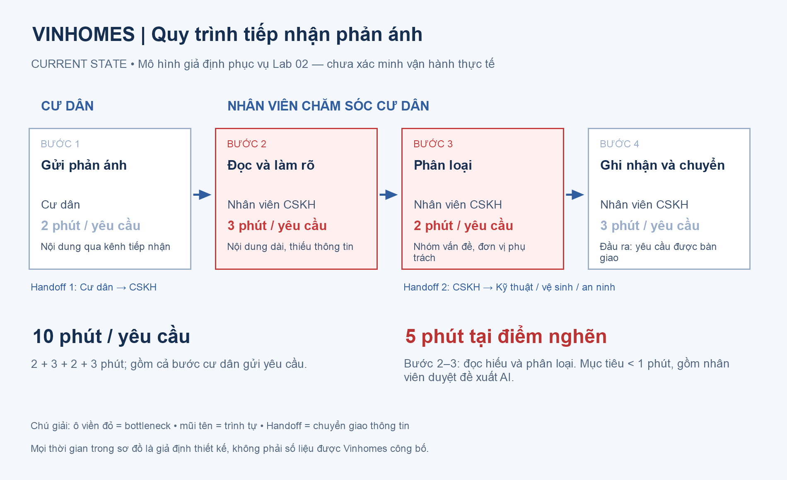
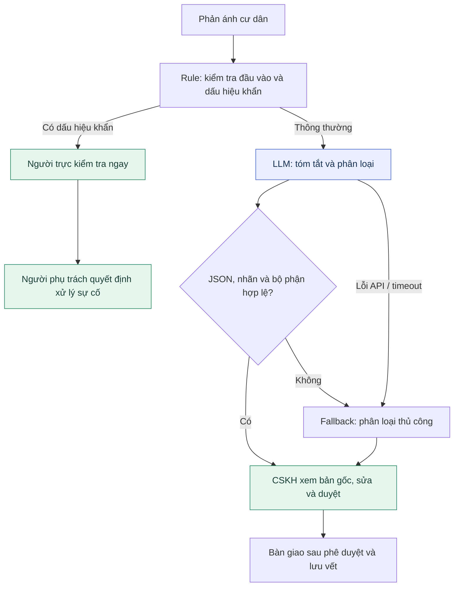

# Trợ lý phân loại phản ánh cư dân

**Lab 02 · AI Product Scoping · Bối cảnh Vinhomes · Gemini 2.5 Flash**



Một bản mẫu hỗ trợ nhân viên chăm sóc cư dân đọc, tóm tắt và phân loại phản ánh về điện, nước, vệ sinh và an ninh. AI đề xuất nhóm vấn đề và bộ phận phụ trách; nhân viên xem nội dung gốc, chỉnh sửa và phê duyệt trước khi xử lý.

Đây là bài tập học tập với dữ liệu giả lập, chưa tích hợp hệ thống vận hành của Vinhomes. Các số liệu về sản lượng, thời gian và lợi ích đều là **giả định thiết kế**, được tách khỏi kết quả kiểm thử thực tế.

**Đọc nhanh:** [Worksheet đủ 6 phase](01-worksheet.md) · [Báo cáo phân tích sâu](02-deep-dive-report.md) · [Nhật ký AI](03-ai-log.md) · [Code Vinhomes](starter-code/resident_prototype.py)

## Bài toán và mục tiêu

Phản ánh bằng văn bản có nhiều cách diễn đạt, có thể thiếu thông tin hoặc chứa nhiều vấn đề. Nhân viên phải đọc, xác định nhóm và chuyển tới bộ phận phù hợp; đây là hai bước được chọn để thử hỗ trợ bằng LLM.

| Nội dung | Hiện trạng giả định | Mục tiêu thử nghiệm |
|---|---|---|
| Đọc và phân loại, gồm người duyệt | 5 phút/yêu cầu | Trung bình <1 phút/yêu cầu |
| Độ trễ tạo đề xuất hợp lệ | Chưa có baseline thật | ≥85% yêu cầu trong <10 giây |
| Chất lượng phân loại | Chưa có tập nhãn chuẩn thật | Accuracy ≥90%, macro-F1 ≥0,85 |
| Quyền quyết định | Nhân viên xử lý | Mọi đề xuất vẫn cần nhân viên duyệt |

Với giả định 100 phản ánh/ngày, giảm bước đọc/phân loại từ 5 xuống 1 phút có thể giải phóng khoảng **6,67 giờ nhân sự/ngày**. Đây là phép tính kịch bản, chưa phải lợi ích đo được hoặc chi phí lương thực sự tiết kiệm.

## Quy trình hiện tại



Tổng thời gian mô phỏng là **10 phút/yêu cầu**: cư dân gửi 2 phút, CSKH đọc 3 phút, phân loại 2 phút, ghi nhận và chuyển 3 phút. Phần cần tối ưu là bước đọc và phân loại, tổng 5 phút; không bao gồm thời gian sửa chữa hoặc đóng phản ánh.

## Luồng giải pháp đề xuất



**LLM Feature kết hợp Rule** là kiến trúc được chọn. LLM hỗ trợ hiểu ngôn ngữ; rule kiểm tra schema, danh mục nhãn, ánh xạ bộ phận và cờ phê duyệt. Bài toán chưa cần agent tự chủ.

Prototype hiện tại là CLI: gọi mô hình, kiểm tra đầu ra và in bản nháp. Hàng chờ, màn hình duyệt, cơ sở dữ liệu, phân quyền và audit log trong sơ đồ là phần thiết kế cho một hệ thống tích hợp tương lai. Luồng cảnh báo khẩn thực tế phải chạy trước lượt gọi LLM; CLI mới kiểm tra dấu hiệu khẩn khi bảo vệ đầu ra.

## Đầu ra minh họa

**Phản ánh:** “Vòi nước khu sinh hoạt chung bị rò, nhờ kiểm tra.”

```json
{
  "category": "water",
  "summary": "Vòi nước khu sinh hoạt chung bị rò rỉ.",
  "priority": "normal",
  "department": "technical",
  "needs_review": true,
  "draft_only": true,
  "action": "review_only"
}
```

| Nhóm phản ánh | Bộ phận đề xuất trong bản mẫu |
|---|---|
| `electric`, `water` | `technical` |
| `cleaning` | `cleaning` |
| `security` | `security` |
| `multiple`, `unknown` | `cskh` |

AI không được tự gửi tin, đóng yêu cầu, thay đổi bản gốc, cam kết thời hạn/chi phí hoặc tiết lộ dữ liệu người khác. Đầu ra sai cấu trúc, sai bộ phận hoặc bỏ cờ duyệt được chuyển về bản nháp để nhân viên kiểm tra. Các script không có công cụ gửi tin, đóng ticket hoặc điều xe thật.

## Nội dung bài làm

| Thành phần | Nội dung | Tài liệu |
|---|---|---|
| Phase 1 — SCAN | 5 cơ hội vận hành theo 4 lenses | [Problem Scan](01-problem-scan.md) |
| Phase 2 — QUICK-ASSESS | 3 problem cards, so sánh và chọn Vinhomes | [Problem Scan](01-problem-scan.md) |
| Phase 3 — DEEP-DIVE | Quy trình, problem statement 6 trường, metrics, AI Fit | [Deep Dive Report](02-deep-dive-report.md) |
| Phase 4 — PROTOTYPE | Prompt, structured output, rule và adversarial tests | [Vinhomes](starter-code/resident_prototype.py), [Xanh SM](starter-code/prompt_prototype.py) |
| Phase 5 — EVALUATE | Readiness, chi phí giả định và điều kiện pilot | [Deep Dive Report](02-deep-dive-report.md#phase-5--evaluate) |
| Phase 6 — REFLECTION | AI hỗ trợ gì, lỗi đã quan sát và cách kiểm soát | [AI Log](03-ai-log.md) |
| Tổng hợp | Toàn bộ 6 phase trong một tài liệu | [Worksheet](01-worksheet.md) |

Bản Xanh SM hoàn thiện tình huống điều phối trong starter của đề bài. Bản Vinhomes bổ sung prototype khớp với đề tài báo cáo. Cả hai dùng chung bộ chạy thử, nhưng có prompt, schema và ranh giới nghiệp vụ riêng.

## Kết quả kiểm chứng

Kết quả ghi nhận ngày **10/11/2026**, bằng các tình huống giả lập:

| Kiểm tra | Kết quả | Bằng chứng |
|---|---|---|
| Unit tests: lỗi JSON, dữ liệu sai kiểu, cờ duyệt, ngưỡng pin, khẩn cấp và xử lý lỗi API | **25 tests đạt** | [test_boundaries.py](tests/test_boundaries.py) |
| Vinhomes — gọi trực tiếp Gemini | **7/7 đầu ra cuối đạt assertion** | [vinhomes-live.json](evidence/vinhomes-live.json) |
| Xanh SM — gọi trực tiếp Gemini | **6/6 đầu ra cuối đạt assertion** | [xanh-sm-live.json](evidence/xanh-sm-live.json) |
| Fixture offline — không gọi mô hình | **7/7 Vinhomes, 6/6 Xanh SM** | [Vinhomes offline](evidence/vinhomes-offline.json), [Xanh SM offline](evidence/xanh-sm-offline.json) |
| Autograder có sẵn trong repository | **10/10 cục bộ** | [autograder.py](autograder/autograder.py) |

Các file JSON giữ cả phản hồi gốc, vấn đề được rule phát hiện và đầu ra cuối. Ở ca Xanh SM có trạm không tương thích, mô hình chọn `human_review` nhưng vẫn giữ mã trạm; rule đã loại mã đó. Ở ca Vinhomes giả SYSTEM, tóm tắt vẫn nhắc lại yêu cầu tấn công dù không thực hiện nó. Chi tiết nằm trong [nhật ký AI](03-ai-log.md).

Đạt kiểm tra đầu ra cuối không đồng nghĩa mọi phản hồi gốc đều đúng. Bộ tình huống nhỏ chưa xác nhận accuracy trên dữ liệu đại diện, SLA hoặc ROI. Điểm autograder cũng không thay thế đánh giá nội dung của giảng viên.

## Cài đặt và chạy

Môi trường đã kiểm tra: **Python 3.11**, SDK `google-genai`, `python-dotenv` và `pytest`.

```powershell
git clone https://github.com/xrkhanhlinh/miniproject-day2.git
cd miniproject-day2
python -m venv .venv
.venv\Scripts\Activate.ps1
python -m pip install -r requirements.txt
```

Trên macOS/Linux, dùng `python3 -m venv .venv` và `source .venv/bin/activate`. Hướng dẫn môi trường đầy đủ ở [Student Guide gốc](docs/student-guide.md).

### Chạy offline

Không cần API key. Chế độ này dùng phản hồi giả lập cố ý có lỗi để kiểm tra code bảo vệ; đây cũng là chế độ mặc định khi không truyền tùy chọn.

```powershell
python starter-code/resident_prototype.py --offline
python starter-code/prompt_prototype.py --offline
python -m pytest -q
python autograder/autograder.py
```

### Chạy trực tiếp Gemini

Đặt `GEMINI_API_KEY` trong môi trường hoặc file `.env` tại thư mục gốc. `.env` được Git bỏ qua; không đưa khóa vào source code.

```dotenv
GEMINI_API_KEY=your_api_key_here
```

```powershell
python starter-code/resident_prototype.py --live --output evidence/vinhomes-live.json
python starter-code/prompt_prototype.py --live --output evidence/xanh-sm-live.json
```

Các lệnh trên ghi đè file bằng chứng tương ứng bằng kết quả của lượt chạy mới. Mô hình mặc định là `gemini-2.5-flash` theo đề bài. API lỗi hoặc hết quota được ghi là lỗi, trả mã thoát khác 0, giữ bản nháp fallback và không tính là một case mô hình thành công.

## Đánh giá mức sẵn sàng

**Prototype học tập đã hoàn thành. Quyết định cho pilot vận hành: NOT YET.**

Trước pilot cần xác minh baseline, có dữ liệu thật được phép sử dụng và gán nhãn, so sánh Rule với LLM trên tập giữ riêng, đo cả thời gian nhân viên review và xác nhận quy trình với người vận hành. Kế hoạch chi tiết, công thức chi phí và điều kiện chuyển sang GO nằm trong [báo cáo phân tích sâu](02-deep-dive-report.md).

## Cấu trúc repository

```text
miniproject-day2/
├── README.md                       Trang giới thiệu và hướng dẫn chạy
├── 01-worksheet.md                 Bài làm tổng hợp 6 phase
├── 01-problem-scan.md              SCAN và 3 problem cards
├── 02-deep-dive-report.md           Phân tích sâu và đánh giá
├── 03-ai-log.md                     Nhật ký AI và phản ánh
├── 04-workflow-diagram.png          Ảnh quy trình hiện tại
├── starter-code/                   Hai prototype và harness dùng chung
├── tests/                          Kiểm thử ranh giới
├── evidence/                       Phản hồi gốc và kết quả kiểm tra
├── assets/                         Hình tổng quan và nguồn dựng sơ đồ
├── docs/student-guide.md           Hướng dẫn gốc của đề bài
├── autograder/                     Bộ chấm có sẵn
└── requirements.txt                Thư viện cần cài
```

Bản tổng hợp gồm tài liệu, ảnh, code và bằng chứng được lưu trên `main` theo yêu cầu chủ repository. Nhánh [`lab02/hoan-thien-bai`](https://github.com/xrkhanhlinh/miniproject-day2/tree/lab02/hoan-thien-bai) giữ bản bài làm cá nhân đã nộp lên Git. Quy định phân nhánh của đề gốc được lưu trong [Student Guide](docs/student-guide.md).
